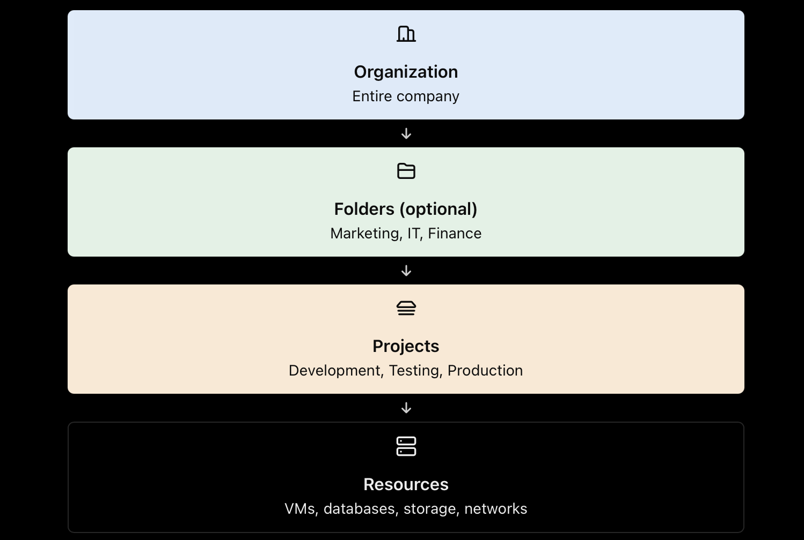

## 8. Creating and Organizing Projects

A project is the basic organizing unit in Google Cloud. It contains resources such as virtual machines, storage buckets, databases, and networks.

Steps to create a project:

1. Open Google Cloud Console.
2. Go to IAM & Admin → Manage Resources.
3. Click Create Project.
4. Enter the project name and project ID.
5. Select the parent organization or folder, if applicable.
6. Create the project and link a billing account when needed.

#### Heare Naming Followed as
```
## Project Naming
[your_purpose]-[Kind_of_project]-[ENV]
```
Example project structure:

- `dev-project` — development resources
- `test-project` — testing resources
- `prod-project` — production resources

Projects help separate workloads, IAM permissions, enabled APIs, and resource management.

Official documentation: [Google Cloud — Creating and Managing Projects](https://cloud.google.com/resource-manager/docs/creating-managing-projects).

## 9. Understanding Organizations, Folders, and Projects

Your attached photos explain the Google Cloud resource hierarchy.



- Organization: Top-level container for a company. It enables centralized management.
- Folders: Optional containers that group projects and other folders.
- Projects: Organize resources and provide a boundary for permissions, APIs, and billing association.
- Resources: Actual cloud services used by applications.

## Extras

- Resource separation: Resources in separate projects are logically separated. Cross-project access can be configured through IAM and service-specific settings.
- Policy inheritance: Applicable IAM and organization policies can flow from an organization to folders and projects. The exact effect depends on the policy type and configuration.
- IAM: Permissions can be granted at different hierarchy levels. Granting access at a higher level can provide access to multiple child resources.
- Billing: Costs can be analyzed by project and grouped by folder or organization.

Example: An IT folder can contain `dev-project` and `prod-project`. Policies assigned at the folder level may apply to both projects.

Correction to remember: A project generally links to a Cloud Billing account; it does not normally have its own separate billing account. One billing account can pay for multiple projects.

Official documentation:

- [Google Cloud — Resource Hierarchy](https://cloud.google.com/resource-manager/docs/cloud-platform-resource-hierarchy)
- [Google Cloud — IAM and Resource Hierarchy](https://cloud.google.com/iam/docs/resource-hierarchy-access-control)

## 10. Billing Account Setup and Configuration

A Cloud Billing account tracks charges and pays for the Google Cloud projects linked to it.

Basic setup:

1. Open the Billing section in Google Cloud Console.
2. Create or select a Cloud Billing account.
3. Configure the required payment profile and payment method.
4. Link the billing account to the relevant project.
5. Assign billing roles only to authorized users.
6. Review cost reports regularly.

Remember the difference:

| Item            | Purpose                                |
| --------------- | -------------------------------------- |
| Project         | Organizes resources                    |
| Billing account | Pays for linked projects               |
| Payment profile | Holds payment and customer information |
| Billing report  | Shows usage and costs                  |

Official documentation: [Google Cloud — Manage Billing Accounts](https://cloud.google.com/billing/docs/how-to/manage-billing-account).

---
