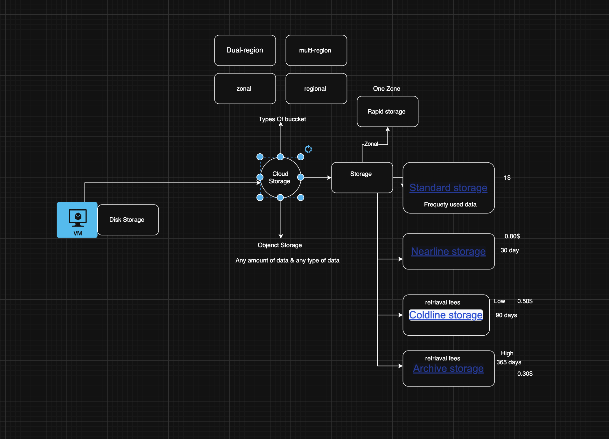

# Google Cloud Storage: Study Notes

Topics covered:

1. Cloud Storage Overview and Storage Classes (Standard, Nearline, Coldline, Archive)
2. Creating and Managing Buckets
3. Uploading, Downloading, and Securing Objects
4. Lifecycle Rules and Versioning

> **Tooling note:** All commands use the modern `gcloud storage` command group (the older `gsutil` tool is being replaced by it). Run them in **Cloud Shell** or any terminal with the Google Cloud CLI installed and logged in. Replace every `my-...` placeholder. Bucket names are **globally unique**.
>
> **Cost warning:** Storage, operations, retrieval, and early-deletion charges apply. Clean up test buckets when done.

---

# 1. Cloud Storage Overview and Storage Classes

## A. Introduction

**Cloud Storage** is Google Cloud's **object storage** service. You store files (called **objects**) inside containers (called **buckets**) and access them over HTTP, the console, the CLI, or client libraries.

**Why we need it**
- Store any amount of unstructured data: images, videos, logs, backups, datasets, static websites.
- No servers or disks to manage. Capacity is effectively unlimited.
- Pick a **storage class** to match how often you read the data, and pay less for rarely used data.

**Object vs block vs file storage**

| Type | Looks like | GCP service | Good for |
|---|---|---|---|
| Object | Flat bucket of objects, accessed by URL/API | Cloud Storage | Media, backups, data lakes |
| Block | A raw disk attached to a VM | Persistent Disk | VM operating systems, databases |
| File | Shared folders (NFS) | Filestore | Shared file systems |

## B. How It Works

```text
Project
  └── Bucket   (globally unique name, one location, one default storage class)
        ├── Object: photos/cat.jpg   (data + metadata)
        └── Object: logs/2026-10.txt
```

- **Object:** the file data plus metadata (name, size, content type, storage class, and so on). Objects are **immutable**: to "edit" one you upload a new version that replaces it.
- **No real folders.** `photos/cat.jpg` is a single object whose name contains a slash. The console only *shows* folders.
- Every storage class gives the same API and the same low-latency access. What changes is **price and minimum duration**.

## Storage Classes

| Class | CLI/API name | Minimum storage duration | Best for | Retrieval fee |
|---|---|---|---|---|
| **Standard** | `STANDARD` | None | Frequently accessed ("hot") data, websites, active apps | No |
| **Nearline** | `NEARLINE` | 30 days | Data read about once a month (monthly backups) | Yes |
| **Coldline** | `COLDLINE` | 90 days | Data read about once a quarter | Yes (higher) |
| **Archive** | `ARCHIVE` | 365 days | Data read less than once a year (compliance, long-term backup) | Yes (highest) |

**Key points from Google's documentation**
- All classes offer unlimited storage and **no minimum object size**.
- Colder classes have **lower storage cost** but **higher access and operation cost**, and slightly lower availability than Standard.
- Archive still has **low-latency (millisecond) access**. It is not like tape or offline archives that need hours to restore.
- For data accessed less than about once a quarter, Coldline or Archive are more cost-effective than Nearline.
- Exact prices and availability figures change, so use the [pricing page](https://cloud.google.com/storage/pricing).

**Minimum storage duration (early deletion charge)**
If you delete, replace, or move an object before its minimum duration, you are charged as if it had been stored for the full minimum duration. Example: deleting a Coldline object after 20 days still costs 90 days of storage. (Soft delete can reduce this charge; see section 4.)

**Related options (know the names)**
- **Autoclass:** automatically moves objects between classes based on access pattern, so you do not write rules.
- **Location type:** *region* (one region), *dual-region* (two regions), *multi-region* (a large area such as US or EU). Wider locations give more resilience and usually cost more.

## C. Real-Life Example

A photo-sharing company:
- **Standard:** photos uploaded this week (viewed constantly).
- **Nearline:** photos 1 to 3 months old (viewed occasionally).
- **Coldline:** photos older than 3 months.
- **Archive:** legal or audit copies kept for years.

Everyday analogy: your desk (Standard), your cupboard (Nearline), your attic (Coldline), a storage unit across town (Archive). Cheaper to keep things farther away, but costlier and slower to fetch.

## D. Practical Example: See the classes in action

```bash
# Create a bucket whose default class is Nearline (location us-central1)
gcloud storage buckets create gs://my-class-demo-12345 \
  --location=us-central1 \
  --default-storage-class=NEARLINE

# Upload one file using the bucket default, one forced to COLDLINE
echo "hello" > a.txt
gcloud storage cp a.txt gs://my-class-demo-12345/a.txt
gcloud storage cp a.txt gs://my-class-demo-12345/b.txt --storage-class=COLDLINE

# Show the storage class of each object
gcloud storage ls -L gs://my-class-demo-12345/
```

- `--default-storage-class`: class given to new objects that do not specify one.
- `--storage-class` on `cp`: sets the class for that one object.
- `ls -L`: long listing; look for the `Storage class:` field.

**Expected result:** `a.txt` shows `NEARLINE`, `b.txt` shows `COLDLINE`.

**Clean up:** `gcloud storage rm -r gs://my-class-demo-12345` (deletes bucket **and** all objects; cannot be undone).

**Troubleshooting**
- *409 bucket exists*: the name is taken globally; choose another.
- *Surprise charge for a deleted object*: check the minimum duration of its class.

## E. Best Practices
1. **Start with Standard for new or unpredictable data**, then move down as access drops (avoids retrieval fees on hot data).
2. **Match class to real access frequency**, not to guesses (cost).
3. **Do not put short-lived data in cold classes** (early-deletion charges).
4. **Consider Autoclass** when access patterns are unknown (cost, less admin).
5. **Choose location by users, compliance, and resilience** (dual/multi-region for higher availability).
6. **Check pricing for operations and egress too**, not just per-GB storage.

## F. Common Mistakes

| Mistake | Why it happens | Fix |
|---|---|---|
| Archive for data read often | Chasing lowest per-GB price | Retrieval and operation fees can exceed the savings; use Standard or Nearline |
| Temporary files in Coldline | Not knowing minimum durations | Use Standard for short-lived data |
| Thinking Cloud Storage has folders | Console shows folders | Remember names are flat; slashes are part of the name |
| Treating it like a disk | Wanting to edit part of a file | Objects are immutable; re-upload the whole object |

## G. Quick Revision
- Cloud Storage = object storage; buckets hold objects.
- Four classes: Standard (hot), Nearline (30 days), Coldline (90 days), Archive (365 days).
- Colder = cheaper storage, costlier access, minimum duration applies.
- All classes: same API, no minimum object size, millisecond access.
- Early deletion charges apply before the minimum duration ends.
- Autoclass can pick classes automatically.

## H. Official Documentation
- [Storage classes](https://docs.cloud.google.com/storage/docs/storage-classes) (verified)
- [Cloud Storage pricing](https://cloud.google.com/storage/pricing) (verified)

## I. Interview Questions
1. **What is Cloud Storage?** Google's scalable object storage service for unstructured data, organized in buckets of objects.
2. **Name the four storage classes and minimum durations.** Standard (none), Nearline (30 days), Coldline (90 days), Archive (365 days).
3. **Does Archive mean slow retrieval?** No. Data is available with low latency, but access and operation costs are higher.
4. **What is an early deletion charge?** A charge for the remaining minimum duration when you delete, replace, or move an object before it has been stored that long.
5. **Cloud Storage vs Persistent Disk?** Cloud Storage is object storage accessed by API/URL; Persistent Disk is block storage attached to VMs.

---

# 2. Creating and Managing Buckets

## A. Introduction

A **bucket** is the top-level container for objects. Every object lives in exactly one bucket. Bucket settings (location, default class, access model, versioning, lifecycle) apply to all its objects.

## B. How It Works

**Settings chosen at creation**

| Setting | Can it change later? | Notes |
|---|---|---|
| **Name** | No | Globally unique across all of Google Cloud; cannot be renamed |
| **Location** (region / dual-region / multi-region) | No | To move, create a new bucket and copy data |
| **Default storage class** | Yes | Affects only *new* objects |
| **Access control** (uniform vs fine-grained) | Yes (with conditions) | Uniform is recommended |
| **Public access prevention** | Yes | Blocks public access |
| **Versioning, lifecycle, soft delete** | Yes | Covered in section 4 |
| **Labels** | Yes | For cost tracking |

**Naming tips:** use lowercase letters, numbers, dashes, underscores; avoid personal or sensitive info in names because bucket names are visible. Check Google's bucket naming rules page for exact limits (see links).

**Main management commands**

| Task | Command |
|---|---|
| Create | `gcloud storage buckets create gs://NAME ...` |
| List | `gcloud storage buckets list` |
| Inspect | `gcloud storage buckets describe gs://NAME` |
| Change settings | `gcloud storage buckets update gs://NAME ...` |
| Delete empty bucket | `gcloud storage buckets delete gs://NAME` |
| Delete bucket and contents | `gcloud storage rm -r gs://NAME` |

## C. Real-Life Example

A company creates **separate buckets per purpose and environment**: `acme-prod-user-uploads`, `acme-prod-backups`, `acme-dev-test-data`. Each has its own location, class, access rules, and lifecycle. If a dev bucket is misconfigured, production is unaffected.

## D. Practical Example: Create, inspect, label, delete

**Prerequisites:** project selected (`gcloud config get-value project`), Storage permissions (for example Storage Admin) on the project.

```bash
# 1. Create a secure bucket
gcloud storage buckets create gs://my-lab-bucket-12345 \
  --location=us-central1 \
  --default-storage-class=STANDARD \
  --uniform-bucket-level-access \
  --public-access-prevention

# 2. List buckets in the project
gcloud storage buckets list

# 3. Inspect the settings
gcloud storage buckets describe gs://my-lab-bucket-12345

# 4. Add a label (for cost tracking)
gcloud storage buckets update gs://my-lab-bucket-12345 --update-labels=env=lab

# 5. Delete (bucket must be empty)
gcloud storage buckets delete gs://my-lab-bucket-12345
```

**Flags explained**
- `--location`: where data is stored (permanent).
- `--uniform-bucket-level-access`: use IAM only; ACLs are disabled.
- `--public-access-prevention`: prevents the bucket from being made public.

**Console steps (alternative):** Console > **Cloud Storage > Buckets > Create** > name > location type and location > default class > access control > protection options > **Create**.

**Expected result:** `describe` shows `location: US-CENTRAL1`, `storage_class: STANDARD`, uniform access enabled, and public access prevention `enforced`.

**Troubleshooting**
- *AccessDenied / 403*: you lack permission on the project or bucket.
- *Name already in use*: names are global; add a random suffix.
- *Bucket not empty on delete*: remove objects first, or use `gcloud storage rm -r` (destructive).
- *Wrong location chosen*: it cannot be changed; create a new bucket and copy objects with `gcloud storage cp -r` or `rsync`.

## E. Best Practices
1. **Choose the location carefully before creating** because it is permanent (latency, compliance, cost).
2. **Enable uniform bucket-level access** so IAM is the single place to manage permissions (security, simplicity).
3. **Enable public access prevention** unless the bucket is meant to be public (security).
4. **Use one bucket per purpose/environment** (isolation, easier lifecycle and permissions).
5. **Label buckets** (team, env, app) for cost reports (cost).
6. **Avoid sensitive data in bucket or object names** (security).

## F. Common Mistakes

| Mistake | Fix |
|---|---|
| Picking the wrong region | Plan first; to fix, create a new bucket and copy |
| Assuming a bucket name is free to reuse right away | Names are global; pick unique names (adding a project-specific prefix helps) |
| Deleting a bucket thinking it keeps a copy | Deletion is destructive; soft delete may help recover recently deleted data (section 4) but do not rely on it as a backup |
| Mixing ACLs and IAM | Use uniform access and IAM only |
| One giant bucket for everything | Split by purpose and environment |

## G. Quick Revision
- Bucket = container; name and location are permanent.
- Names are globally unique.
- Use `gcloud storage buckets create/list/describe/update/delete`.
- Enable uniform access and public access prevention for safety.
- Default class affects only new objects.
- Label buckets for cost tracking.

## H. Official Documentation
- [gcloud storage command reference](https://docs.cloud.google.com/sdk/gcloud/reference/storage) (verified)
- [Access control overview](https://docs.cloud.google.com/storage/docs/accesscontrol) (verified)
- [Geography and regions (locations)](https://docs.cloud.google.com/docs/geography-and-regions) (verified)
- Bucket naming rules and "Create buckets" pages: **unverified**, search "Cloud Storage bucket naming" in the Cloud Storage docs.

## I. Interview Questions
1. **What can you not change after creating a bucket?** Its name and location.
2. **How do you move a bucket to another region?** Create a new bucket in the target location and copy the data.
3. **Region vs dual-region vs multi-region?** One region, two specific regions, or a broad geographic area; wider options give more resilience at higher cost.
4. **What is uniform bucket-level access?** An access mode that disables ACLs so IAM alone controls permissions.
5. **Why create separate buckets per environment?** Isolation of permissions, lifecycle rules, and costs.

---

# 3. Uploading, Downloading, and Securing Objects

## A. Introduction

Once you have a bucket you **upload** (write), **download** (read), and **secure** (control who can do either) objects. Security in Cloud Storage is mainly handled with **IAM**, **public access prevention**, **signed URLs**, and **encryption**.

## B. How It Works

**Ways to upload/download:** Console (drag and drop), `gcloud storage cp`, `gcloud storage rsync`, client libraries, REST API.

**Access control options**

| Option | What it does | Use when |
|---|---|---|
| **IAM** (with uniform access) | Grants roles on project, bucket, or managed folder | Default choice for everything |
| **ACLs** (fine-grained) | Per-object permissions | Only for legacy needs |
| **Public access prevention** | Blocks any public access to the bucket | Private data (recommended) |
| **Signed URL** | Time-limited link giving read or write on one object | Share a file temporarily without a Google account |
| **Signed policy document** | Controls browser form uploads (size, type) | Letting website visitors upload |

**Common IAM roles**

| Role | Allows |
|---|---|
| `roles/storage.objectViewer` | Read/list objects |
| `roles/storage.objectCreator` | Upload objects (no read/delete) |
| `roles/storage.objectUser` | Read, write, and delete objects |
| `roles/storage.admin` | Full control of buckets and objects |

(Role names are standard; confirm exact permissions in the IAM roles reference before using in production.)

**Encryption:** data is encrypted at rest by default with Google-managed keys. You can optionally use **customer-managed keys (Cloud KMS)**. Data in transit uses HTTPS/TLS.

**Download flow**
```text
Request -> IAM check (or valid signed URL) -> object returned over HTTPS
```

## C. Real-Life Example

An HR system stores payslips in a private bucket (public access prevention on). Employees open payslips through the company web app, which generates a **signed URL valid for 10 minutes**. After that the link stops working. The bucket is never made public, and only the app's service account has the viewer role.

## D. Practical Example: Upload, download, grant access, share temporarily

**Prerequisite:** a bucket from section 2 (`gs://my-lab-bucket-12345`).

```bash
# Upload one file, then a whole folder
echo "payslip data" > report.txt
gcloud storage cp report.txt gs://my-lab-bucket-12345/
mkdir -p docs && echo "a" > docs/a.txt && echo "b" > docs/b.txt
gcloud storage cp -r docs gs://my-lab-bucket-12345/

# List
gcloud storage ls gs://my-lab-bucket-12345/

# Download
gcloud storage cp gs://my-lab-bucket-12345/report.txt ./downloaded-report.txt

# Keep a folder in sync (copies only differences)
gcloud storage rsync -r docs gs://my-lab-bucket-12345/docs

# Give a teammate read-only access to this bucket
gcloud storage buckets add-iam-policy-binding gs://my-lab-bucket-12345 \
  --member="user:teammate@example.com" \
  --role="roles/storage.objectViewer"

# Make a 10-minute shareable link (see note below)
gcloud storage sign-url gs://my-lab-bucket-12345/report.txt \
  --duration=10m \
  --impersonate-service-account=SERVICE_ACCOUNT_EMAIL
```

**Notes on `sign-url`**
- It needs a credential that can sign: either a service account key file (`--private-key-file`, avoid keys where possible) or impersonating a service account (`--impersonate-service-account`), which requires the **Service Account Token Creator** role on that account.
- Treat the resulting URL like a password: **anyone who has it can use it until it expires**.

**Expected output**
- `ls` shows `report.txt` and `docs/`.
- The downloaded file contains `payslip data`.
- `sign-url` prints a long URL; opening it in a browser downloads the file until expiry.

**Verify security settings**
```bash
gcloud storage buckets describe gs://my-lab-bucket-12345
gcloud storage buckets get-iam-policy gs://my-lab-bucket-12345
```

**Clean up:** `gcloud storage rm -r gs://my-lab-bucket-12345` (destructive).

**Troubleshooting**
- *403 on upload/download*: check the IAM role on the bucket and that you are in the right project.
- *Signed URL returns "SignatureDoesNotMatch" or expired*: check clock, duration, and that the signer has access to the object.
- *Cannot make object public*: public access prevention is on (this is correct behavior). Change it only if public hosting is really intended.
- *Big uploads slow*: `gcloud storage cp` parallelizes automatically; check your network bandwidth.

## E. Best Practices
1. **Use uniform access plus IAM** and grant roles at the **narrowest scope** (least privilege).
2. **Enable public access prevention** on anything not meant to be public.
3. **Prefer signed URLs or an app layer** over making a bucket public, and keep expiry short.
4. **Use service accounts, not personal accounts, for applications**; avoid downloading service account keys.
5. **Consider customer-managed keys (Cloud KMS)** for regulated data.
6. **Turn on audit logging for data access** on sensitive buckets to see who read what.
7. **Use `rsync` for repeatable syncs** and `cp -r` for one-offs (reliability, speed).

## F. Common Mistakes

| Mistake | Why it is risky | Fix |
|---|---|---|
| Granting `allUsers` access | Anyone on the internet can read (or even write) | Remove it; use signed URLs or authenticated access |
| Giving `storage.admin` to everyone | Too much power | Use `objectViewer` / `objectCreator` / `objectUser` |
| Long-lived signed URLs | URL is a bearer credential | Keep expiry minutes to hours, not months |
| Committing service account keys to Git | Key leaks give full access | Use impersonation or workload identity; rotate leaked keys |
| Using `-r` without checking the destination | Overwrites or copies the wrong folder | Test with a small folder first; check paths |
| Forgetting that overwrites replace data | Immutable objects mean new upload replaces old | Enable versioning (section 4) |

## G. Quick Revision
- Upload/download: `gcloud storage cp` (`-r` for folders), `rsync` to sync.
- Access: IAM + uniform access; avoid ACLs.
- Public access prevention blocks public exposure.
- Signed URL = temporary access to one object; guard it like a password.
- Data is encrypted at rest by default; Cloud KMS keys are optional.
- Use least privilege and service accounts.

## H. Official Documentation
- [Access control overview (IAM, ACLs, signed URLs, public access prevention)](https://docs.cloud.google.com/storage/docs/accesscontrol) (verified)
- [gcloud storage reference (cp, ls, rm, rsync, and more)](https://docs.cloud.google.com/sdk/gcloud/reference/storage) (verified)
- [Transition from gsutil to gcloud storage](https://cloud.google.com/storage/docs/gsutil-transition-to-gcloud) (verified)
- Public access prevention page `https://docs.cloud.google.com/storage/docs/public-access-prevention`: **seen as a reference link in a third-party source, not opened directly (unverified)**.

## I. Interview Questions
1. **How do you share a private object temporarily?** Generate a signed URL with a short expiry.
2. **Uniform bucket-level access vs ACLs?** Uniform uses IAM only (recommended); ACLs give per-object permissions and are mostly legacy.
3. **What does public access prevention do?** Prevents the bucket and its objects from being exposed publicly, even if someone tries to grant public access.
4. **How is data protected at rest?** Encrypted by default with Google-managed keys; customer-managed keys via Cloud KMS are optional.
5. **Why are signed URLs risky?** Anyone holding the URL can use it until it expires, so keep it short-lived and private.

---

# 4. Lifecycle Rules and Versioning

## A. Introduction

- **Object Lifecycle Management** automatically **changes the class of** or **deletes** objects when they meet conditions (for example, older than 30 days). It saves money and removes manual clean-up.
- **Object Versioning** keeps **older versions** of an object when it is overwritten or deleted, so you can recover from mistakes.
- **Soft delete** (on by default) is a separate safety net that keeps deleted objects recoverable for a short time.

## B. How It Works

### Lifecycle rules
A lifecycle configuration is a set of **rules** set on a bucket. Each rule has **one action** and **one or more conditions**.

| Action | What it does |
|---|---|
| `Delete` | Deletes the object when all conditions match |
| `SetStorageClass` | Changes the object's storage class when all conditions match |

**Common conditions:** `age` (days since creation), `createdBefore` (date), `isLive` (live vs noncurrent version), `numNewerVersions`, `daysSinceNoncurrentTime`, `matchesStorageClass`, and `matchesPrefix` / `matchesSuffix` (limit to certain names).

**Facts from Google's documentation**
- Rules run automatically, but **changes to a lifecycle configuration can take up to 24 hours** to take effect.
- If several rules match one object at the same time, Cloud Storage performs only one action. Check the lifecycle documentation for the precedence rules.
- Cloud Storage does not validate whether your storage class transition makes sense. Design them carefully (typically from warmer to colder).
- There is no guaranteed exact time of execution.

### Versioning
- When versioning is on, overwriting or deleting a **live** object makes it a **noncurrent** version instead of removing it.
- Each version has a unique **generation number**. Restore by copying an old generation back as the live object.
- Noncurrent versions **cost storage**, so pair versioning with lifecycle rules that remove old versions.

```text
Upload v1  -> live: v1
Upload v2  -> live: v2, noncurrent: v1
Delete     -> live: none, noncurrent: v2, v1
```

### Soft delete (related)
- Enabled by default with a **7-day** retention; configurable from **7 to 90 days**, and can be disabled by setting 0.
- Deleted objects (and buckets) can be restored during the retention period, after which they are permanently deleted.
- With versioning on: deleting a live object makes it noncurrent; deleting a noncurrent object makes it soft-deleted.
- Soft-deleted data is still billed during the retention period.

### Comparison

| Feature | Versioning | Soft delete | Lifecycle rules |
|---|---|---|---|
| Purpose | Keep older versions | Recover recent deletions | Automate class change/deletion |
| Default state | Off | On (7 days) | None |
| Protects against | Overwrites and deletes | Accidental deletion | Not a protection tool; it is automation |
| Costs extra storage | Yes | Yes (during retention) | Can reduce cost |

## C. Real-Life Example

A company keeps application logs:
- Days 0 to 30: **Standard** (engineers search them often).
- After 30 days: **Nearline**. After 90 days: **Coldline**. After 365 days: **Archive**.
- After 7 years: **delete** (legal retention period ends).

And for a bucket of editable documents, versioning is on, and a rule deletes noncurrent versions older than 30 days so history does not grow forever.

## D. Practical Example: Versioning plus lifecycle

**Prerequisite:** a bucket (use a test bucket).

**Step 1. Enable versioning and test it**
```bash
gcloud storage buckets update gs://my-lab-bucket-12345 --versioning

echo "version one" > note.txt
gcloud storage cp note.txt gs://my-lab-bucket-12345/note.txt
echo "version two" > note.txt
gcloud storage cp note.txt gs://my-lab-bucket-12345/note.txt

# List all versions (note the numbers after '#': these are generations)
gcloud storage ls --all-versions gs://my-lab-bucket-12345/note.txt
```

**Expected output:** two lines such as `gs://.../note.txt#1730000000000001` and `...#1730000000000002` (numbers will differ).

**Step 2. Restore the old version**
```bash
# Copy the older generation over the live object
gcloud storage cp "gs://my-lab-bucket-12345/note.txt#OLD_GENERATION_NUMBER" \
  gs://my-lab-bucket-12345/note.txt
```
Replace `OLD_GENERATION_NUMBER` with the first number from the listing. The restored content becomes a new live version.

**Step 3. Create `lifecycle.json`**
```json
{
  "rule": [
    {
      "action": {"type": "SetStorageClass", "storageClass": "NEARLINE"},
      "condition": {"age": 30, "matchesStorageClass": ["STANDARD"]}
    },
    {
      "action": {"type": "SetStorageClass", "storageClass": "COLDLINE"},
      "condition": {"age": 90, "matchesStorageClass": ["NEARLINE"]}
    },
    {
      "action": {"type": "SetStorageClass", "storageClass": "ARCHIVE"},
      "condition": {"age": 365, "matchesStorageClass": ["COLDLINE"]}
    },
    {
      "action": {"type": "Delete"},
      "condition": {"isLive": false, "daysSinceNoncurrentTime": 30}
    }
  ]
}
```

**Step 4. Apply, view, and (optionally) remove**
```bash
gcloud storage buckets update gs://my-lab-bucket-12345 --lifecycle-file=lifecycle.json

# View the stored configuration
gcloud storage buckets describe gs://my-lab-bucket-12345 --format="default(lifecycle_config)"

# Remove all lifecycle rules
gcloud storage buckets update gs://my-lab-bucket-12345 --clear-lifecycle
```

**Rule explanation:** the first three rules move aging objects to colder classes. The last rule permanently deletes noncurrent versions 30 days after they became noncurrent.

**Soft delete commands (optional)**
```bash
# Set soft delete retention to 14 days
gcloud storage buckets update gs://my-lab-bucket-12345 --soft-delete-duration=14d
# List soft-deleted objects and restore: see 'gcloud storage ls --soft-deleted'
# and 'gcloud storage restore' (run --help to confirm flags for your CLI version)
```

**Expected result:** versioning shows enabled in `describe`; the lifecycle config shows your four rules. Rules act within about a day, not instantly, and objects only change when they actually meet the age conditions.

**Clean up:** delete all versions, then the bucket:
```bash
gcloud storage rm -r gs://my-lab-bucket-12345
```
(With versioning on, `rm -r` also removes noncurrent versions of the objects it deletes. Confirm with `ls --all-versions` that nothing remains. Soft-deleted data is retained for the soft delete period.)

**Troubleshooting**
- *Rules not working yet*: allow up to 24 hours after changing the configuration.
- *Storage grows with versioning*: add `numNewerVersions` or `daysSinceNoncurrentTime` delete rules.
- *Unexpected early-deletion charges*: moving or deleting objects before the minimum duration of their class still charges the remainder.
- *Invalid JSON error*: validate the file (for example with `python3 -m json.tool lifecycle.json`).
- *Rule matched nothing*: check `matchesStorageClass`, prefix/suffix, and `age`.

## E. Best Practices
1. **Turn on versioning for important, changing data** and always add a rule to expire old versions (protects data, controls cost).
2. **Move data through classes only when access truly drops** (cost; avoid retrieval fees).
3. **Respect minimum storage durations** when writing rules, so you do not trigger early-deletion charges.
4. **Test lifecycle rules on a test bucket or a prefix first** because deletes are permanent after retention (safety).
5. **Use prefixes** (`matchesPrefix`) so logs, backups, and uploads get different rules.
6. **Do not treat soft delete or versioning as a full backup**; keep separate backups for critical data (reliability).
7. **Consider Autoclass** instead of hand-written class rules when access patterns are unpredictable.

## F. Common Mistakes

| Mistake | Why it happens | Fix |
|---|---|---|
| Versioning on, no cleanup rule | Costs grow silently | Add `Delete` rules for noncurrent versions |
| Expecting instant lifecycle action | Rules are periodic and take up to 24 hours to apply after change | Plan for delay |
| Delete rule with too short an age | Typo or misunderstanding | Double-check units (days) and conditions; test first |
| Moving objects to Archive then reading often | Wrong access assumption | Review access logs before choosing the class |
| Confusing versioning and soft delete | Both keep deleted data | Versioning keeps old versions indefinitely until removed; soft delete keeps deletions for a short fixed period |
| Rules in the wrong order of classes | Cloud Storage does not validate transitions | Use warm to cold only, with matching conditions |

## G. Quick Revision
- Lifecycle = automatic `Delete` or `SetStorageClass` based on conditions.
- Rule = one action + one or more conditions; set on the bucket as JSON.
- Changes can take up to 24 hours to apply.
- Versioning keeps noncurrent versions; each has a generation number.
- Restore a version by copying `object#GENERATION` back.
- Soft delete: on by default, 7 days (7 to 90, or 0 to disable).
- Combine versioning with lifecycle cleanup to control cost.

## H. Official Documentation
- [Object Lifecycle Management](https://docs.cloud.google.com/storage/docs/lifecycle) (verified)
- [Soft delete](https://docs.cloud.google.com/storage/docs/soft-delete) (verified)
- [Storage classes](https://docs.cloud.google.com/storage/docs/storage-classes) (verified)
- [Cloud Storage pricing (minimum duration and early deletion)](https://cloud.google.com/storage/pricing) (verified)
- Object Versioning page `https://docs.cloud.google.com/storage/docs/object-versioning`: **unverified**. It was not returned in my searches, so search "Cloud Storage Object Versioning" in the docs to confirm.

## I. Interview Questions
1. **What are the two lifecycle actions?** `Delete` and `SetStorageClass`.
2. **How do you reduce cost for aging data automatically?** A lifecycle rule that moves objects to colder classes by age, such as Standard to Nearline at 30 days.
3. **What happens to a live object when versioning is on and you delete it?** It becomes a noncurrent version and can be restored using its generation number.
4. **Versioning vs soft delete?** Versioning keeps older versions until you remove them; soft delete keeps deleted objects for a fixed retention (7 days by default, up to 90) and then permanently deletes them.
5. **Why can lifecycle rules produce unexpected bills?** Moving or deleting before minimum storage duration triggers early-deletion charges, and versioning without cleanup keeps adding storage.

---

## Verification Status

| Item | Status |
|---|---|
| Class minimum durations (30/90/365 days), no minimum object size, low-latency Archive | Verified on Google storage classes page |
| Early deletion charge behavior | Verified on Google pricing page |
| Lifecycle actions, 24-hour propagation, one action per object | Verified on Google lifecycle page |
| Soft delete default 7 days, range 7 to 90, versioning interaction | Verified on Google soft delete page |
| Uniform access, signed URLs, public access prevention concepts | Verified on Google access control page |
| `gcloud storage` command group (cp, ls, rm, rsync, buckets) | Verified on gcloud reference |
| Exact flags (`--soft-delete-duration`, `sign-url`, `--lifecycle-file`, `restore`, IAM role names) and the full list of lifecycle conditions | **Written from standard CLI/API usage, not individually confirmed on the reference pages.** Run `--help` for your CLI version before relying on them |
| Bucket naming rules, versioning doc URL, public access prevention URL | **Unverified** |
